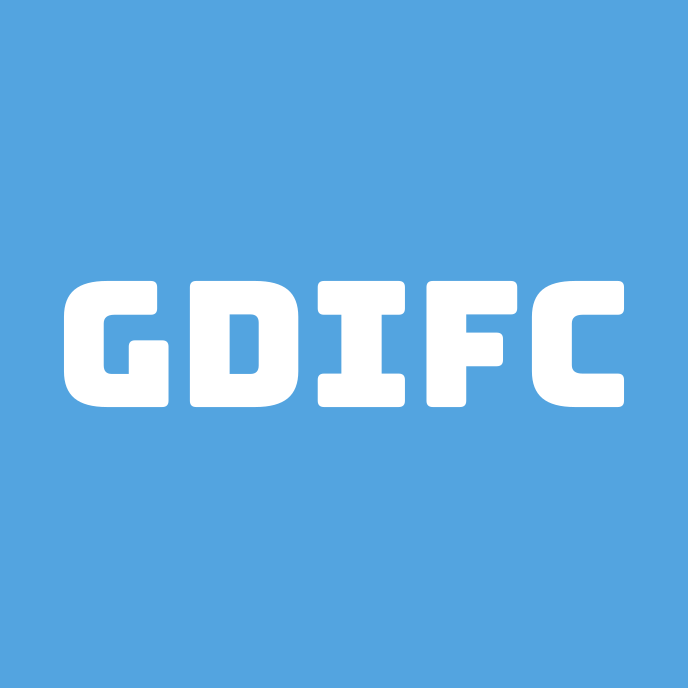
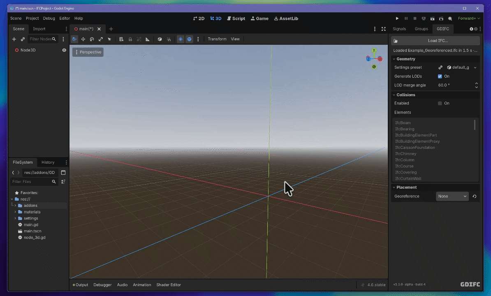

# GDIFC



A GDExtension for loading [buildingSMART IFC](https://www.buildingsmart.org/standards/bsi-standards/industry-foundation-classes/) files directly in Godot 4.  


## Features

- Asynchronous, threaded loading — the editor and game remain responsive while the model is parsed, with progress reporting
- IFC schema support: IFC 2.3.0.1 (IFC 2x3 TC1), IFC 4.0.2.1 (IFC 4 ADD2 TC1), 4.3.2.0 (IFC 4.3 ADD2)
- `.ifc` files imported as scenes, like `.glb` files
- Per-object attributes, property sets and quantity sets exposed as `Dictionary`, with the element type's sets merged in and the value type and unit of each value
- The whole IFC model can be walked from any element: every IFC class of the three schemas is a typed Godot class (`IfcWall`, `IfcSlab`, …) whose attributes and inverse relationships lead to its type, classifications, systems, zones, openings and every other entity, including those without geometry
- Optional IFC materials and textures, with one Godot material per IFC material that can be replaced from scripts or the Inspector
- Automatic mesh LODs
- Optional collision shape generation per object, with a shape type and physics layers per IFC class
- Georeferencing data (`MapConversion` / `ProjectedCRS`, and IFC2X3's `ePSet_MapConversion`), and placing models relative to each other's georeference
- Platforms: Windows, Linux, Android, Web (WASM)

<p align="center">
  
</p>

IFC 4.3 example on godot 4.7 dev outline branch

## Requirements

Godot 4.5 or later.

## Installation

### Godot Asset Library (recommended)

1. Open your Godot 4 project.
2. Go to **AssetLib** tab → search for **GDIFC**.
3. Click **Download** → **Install**.
4. Enable the plugin under **Project → Project Settings → Plugins**.

### Manual

1. Copy the `addons/GDIFC/` folder into your project's `res://addons/` directory.
2. Enable the plugin under **Project → Project Settings → Plugins**.

## Quick Start

In the editor, drag an `.ifc` file from the FileSystem dock into the 3D view, or use **Load IFC...** in the GDIFC dock.

From a script, add a **GDIFCManager** node to your scene and call `read_ifc`:

```gdscript
extends Node3D

@onready var ifc_manager: GDIFCManager = $GDIFCManager

func _ready() -> void:
    ifc_manager.ifc_objects_ready.connect(_on_ifc_objects_ready)
    ifc_manager.read_ifc("res://models/building.ifc")

func _on_ifc_objects_ready() -> void:
    for node in ifc_manager.find_children("*", "IFCNode", true, false):
        var wall := node.ifc_object as IfcWall
        if wall:
            print(wall.Name, " ", node.properties.keys())
```

The model appears at `ifc_read`, as an `IFCModel` node under the manager holding the `IFCNode` tree. Attributes, property sets, quantities and the typed `ifc_object` follow at `ifc_objects_ready`.

## Documentation

- [Getting Started](docs/getting-started.md)
- [Loading Models](docs/loading-models.md): collision, importing as scenes, LODs, IFC materials, georeferencing
- [Typed Entity Access](docs/typed-entities.md)
- [Walking The Model](docs/walking-the-model.md): types, classifications, systems, openings and entities without a node
- [API Reference](docs/api-reference.md)
- [Building From Source](docs/building-from-source.md)
- [Changelog](CHANGELOG.md)

## Dependencies

| Library | Purpose |
|---|---|
| [web-ifc](https://github.com/ThatOpen/engine_web-ifc) | Geometry processing — converts IFC solid geometry into triangle meshes |
| [IfcOpenShell / IfcParse](https://ifcopenshell.org) | IFC file parsing and schema support |
| [godot-cpp](https://github.com/godotengine/godot-cpp) | Godot 4 GDExtension C++ bindings |

## Licence

See [LICENCE.md](LICENCE.md).
